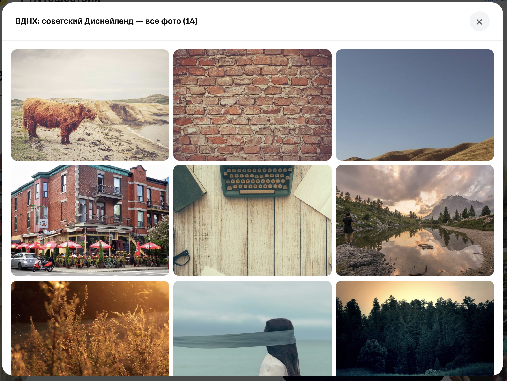
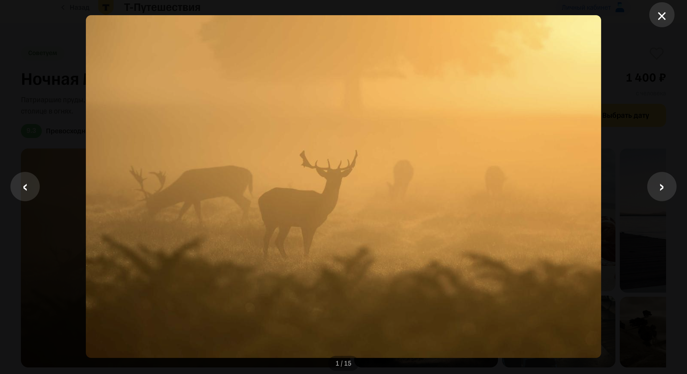

# React Adaptive Photo Gallery

[](https://www.npmjs.com/package/react-photo-gallery-adaptive)
[](https://www.npmjs.com/package/react-photo-gallery-adaptive)
[](https://bundlephobia.com/package/react-photo-gallery-adaptive)


[](https://github.com/niqeru/react-photo-gallery-adaptive/blob/main/LICENSE)

**[Live demo →](https://niqeru.github.io/react-photo-gallery-adaptive/)**

## Preview

<p align="center">
  
  <br />
  
  <br />
  
  
</p>

An adaptive React component for image galleries with dynamic aspect-ratio layout calculations, a full-screen lightbox, and a responsive view-all modal.

## Features
- 📐 **Dynamic Layout:** Automatically calculates column widths and cell flex values based on image ratios.
- 🔍 **Interactive Lightbox:** Full-screen image preview with keyboard navigation (Arrow keys and Escape).
- 🖼️ **"View All" Modal:** Grid modal for browsing all uploaded photos when the total count exceeds the display limit.
- 📱 **Fully Responsive:** Smooth layout adjustments across mobile, tablet, and desktop breakpoints.

## Installation

```bash
npm install react-photo-gallery-adaptive
```

Requires React 16.8+ (hooks). Styles are bundled into the component, no separate CSS import needed.

## Quick Start

```jsx
import PhotoGallery from "react-photo-gallery-adaptive";

const photos = [
  "https://picsum.photos/800/600",
  "https://picsum.photos/600/800",
  "https://picsum.photos/800/800",
  "https://picsum.photos/1200/800",
];

export default function App() {
  return (
    <div style={{ maxWidth: 1000, margin: "0 auto", padding: 24 }}>
      <PhotoGallery photos={photos} title="Vacation Photos" />
    </div>
  );
}
```

Works with Vite, webpack/CRA, Next.js (App Router and Pages Router) and plain Node (ESM and CommonJS). TypeScript types are included.

## Props

| Prop     | Type       | Default     | Description                                                                   |
| -------- | ---------- | ----------- | ----------------------------------------------------------------------------- |
| `photos` | `string[]` | (required)  | Image URLs. Up to 11 are shown in the grid; the rest open in the "More" modal. |
| `title`  | `string`   | `"Gallery"` | Used in image alt text and the header of the "all photos" modal.             |

## Local demo

```bash
npm install
npm run dev
```

Then open http://localhost:4173/ in the browser. The same demo is deployed to [GitHub Pages](https://niqeru.github.io/react-photo-gallery-adaptive/) on every push to `main`.
